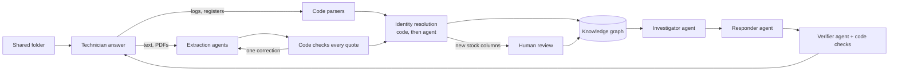

# Multi-agent knowledge graph construction and retrieval

**Evidence-grounded troubleshooting for factory maintenance.**

A customer's shared folder of messy maintenance files (walkdown notes, controller
logs, shift handovers, work orders, stores exports and PDF manuals) becomes an
evidence-backed knowledge graph, built by a multi-agent pipeline. A second set of
agents then retrieves from that graph to answer technicians' questions.

Every fact in the graph, and every statement in an answer, cites the exact source lines it
came from.

## Features

**Knowledge graph construction**

- **Multi-agent pipeline on LangGraph:** a triage agent routes each file by its content,
  never its name; typed extraction agents handle each document type; a reconciliation
  agent resolves equipment mentions that code cannot match exactly.
- **Verified extraction:** agents point at source text instead of writing facts. Code
  finds that text in the file and publishes only what it can verify. A failed check gets
  one correction round, then the item is held, not guessed.
- **Hybrid parsing:** controller logs and registers go through deterministic parsers;
  free text and PDFs go to the agents.
- **Human-in-the-loop schema review:** unfamiliar columns become proposals that a
  reviewer approves, edits, rejects or defers, without blocking the rest of the build.
- **Reproducible and incremental:** every agent decision is cached by its exact input
  and prompt, so builds replay with no API key. Live builds call the model only for
  new or changed files.
- **Live file uploads:** add a file in the app and watch only that file go through the
  agents. Removed or changed files leave no stale facts, and earlier graph versions
  are kept.
- **Optional Neo4j projection** of the validated graph, run locally with Docker.

**Retrieval and answering**

- **Investigator, responder and verifier agents:** the investigator gathers evidence
  with read-only graph tools, the responder writes a short answer and the verifier
  checks every claim against its sources.
- **Rules enforced in code, not prompts:** causes and next steps must cite guidance.
  Counts, maintenance records, stock and the site's safety boundary are rendered from
  the graph, never from model wording. Unsupported claims are removed individually.
- **Point-in-time answers:** ask "as of the incident" or across all records. A fact
  shows only the citations known at that time.
- **Bounded fallback:** when the graph holds nothing on a question, one bounded search
  of the source text answers instead.
- **Clarifying questions and follow-ups:** an ambiguous machine gets a neutral
  question built from the candidates. Conversations keep their context.
- **Clickable sources:** every answer shows the exact lines it rests on, and each
  source file opens in full.

**Evaluation**

- 53/53 construction gold checks in 3 of 3 fresh live builds.
- On 32 rubric cases, judged by a separate model, the graph system passed **45/64
  answers with 1 material error**. The same agents using document search only passed
  32/64 with 8.
- Walkthrough notebooks for construction, answering and evaluation that run without
  an API key, plus offline tests in CI.

## Documentation

| Read | For |
|---|---|
| [Concept](docs/concept.md) | Problem, discovery, assumptions, requirements, decisions, pilot plan |
| [Knowledge model](docs/knowledge-model.md) | Ontology and how each file maps into the graph |
| [Construction pipeline](docs/construction-pipeline.md) | The multi-agent build from messy files |
| [Technician assistant](docs/technician-assistant.md) | The answering agents, with one execution trace |
| [Target architecture](docs/target-architecture.md) | Proposed production system beyond the PoC: what changes, deployment and data boundary, tooling options |
| [Evaluation](evaluation/README.md) | Results against a document-search baseline |

## Run locally

Python 3.13 was tested. No hosted database is required.

```sh
python3 -m venv .venv
.venv/bin/python -m pip install -r requirements.lock
.venv/bin/python -m pip install --no-deps -e .
.venv/bin/factory-demo build
.venv/bin/streamlit run app.py --server.address 127.0.0.1
```

`build` replays the recorded agent decisions in `agent_cache/`, so it needs no API key
and reproduces the recorded graph exactly. For live agents, copy `.env.example` to
`.env`, set your key locally (never commit it), and use `build --mode live`: only new
or changed files are sent to the model. Live mode sends the fictional files to OpenAI.

## How it works



- **Triage agent:** reads each file and decides what it is. Routing never uses file
  names.
- **Extraction agents:** one typed contract per document type. They point at source
  text; code finds that text in the file and publishes only what it can verify.
- **Reconciliation agent:** matches equipment mentions that code cannot match exactly.
  Its matches stay labelled, and ambiguous references are held.
- **Human review:** the build files a proposal for unfamiliar stock columns without
  blocking other files.
- **Assistant:** an investigator gathers evidence with read-only graph tools (one call
  assembles a stoppage's full context), a responder writes a short answer (findings,
  possible causes, next steps, one question) and a verifier checks every claim against its
  sources. Counts, records, stock and the safety boundary are rendered by code. When the
  graph holds nothing on the question, one bounded search of the source text is the
  fallback.

## What to try

| Where | Try |
|---|---|
| 💬 Ask about a problem | Pick **Troubleshoot a stop**; watch each step; read the answer, its next steps and the safety note; open **Sources** to see the exact lines, and click a file name to open the whole file in a new tab |
| 💬 Ask about a problem | Then reply: “We found a roller underneath the belt that barely turns. Which part do we need, and is one in stock?” |
| 🔧 Equipment | Choose CV-01 and CV-02: setup, applicable manual, approved parts and dated stock, events and shift notes, history |
| 🏗️ Build & review → Build knowledge | Build (replay); inspect each file's route, agent calls, corrections and held items |
| 🏗️ Build & review → ➕ Add a file | Upload `demo_files/night_shift_15oct.txt` (live, needs the key); watch it build and see what it added. Remove it again from **Files added here** |
| 🏗️ Build & review → Review schema changes | Approve the reserved-quantity column; its stock records publish |

The sidebar chooses the line, which records to use (**At the incident**, 08:20 on
14 October, or **All records**) and live AI answers versus an evidence preview.

## Walkthrough notebooks

Three steps, each with a concise version and a detailed, narrated one:

| Notebook | Shows |
|---|---|
| 01 construction ([concise](notebooks/01_kg_construction_concise.ipynb), [detailed](notebooks/01_kg_construction_detailed.ipynb)) | Folder to graph: triage, parsers, extraction and its source checks, correction and re-route, identity resolution, assembly, schema review, gold checks |
| 02 question to answer ([concise](notebooks/02_question_to_answer_concise.ipynb), [detailed](notebooks/02_question_to_answer_detailed.ipynb)) | One technician question through the records time, the graph tools, the investigator, responder and verifier, the code checks and the released answer; then a follow-up, an unclear machine, a forbidden request and the source-text fallback |
| [03 evaluation](notebooks/03_evaluation.ipynb) | Gold checks, rubric cases, the document-search baseline, results by family, answers side by side, remaining failures, how results moved |

All run without an API key. Construction replays `agent_cache/`; notebook 02 replays model
outputs recorded in `notebooks/recorded/answers.json` (set `MODE = "live"` to ask new
questions); notebook 03 reads the saved evaluation runs. Review decisions go to a throwaway
folder, not `.runtime`.

```sh
.venv/bin/python -m pip install -e ".[notebooks]"
.venv/bin/jupyter lab notebooks/
```

## Validation

```sh
.venv/bin/pytest -q                # no model calls; replay and scripted agents
.venv/bin/ruff check src tests app.py
RUN_NEO4J_TESTS=1 .venv/bin/pytest -q   # optional, with local Neo4j running
```

**Evaluation** ([details](evaluation/README.md)): construction passes 53/53 gold checks in
3 of 3 fresh live builds. On 32 rubric cases (2 runs each, judged by gpt-4.1), the graph
system with its source-text fallback passed **45/64 answers with 1 material error**,
against 32/64 and 8 for the same agents using document search only. Before the fallback,
the graph made no material errors but was less complete on new questions. These are
synthetic files and a small sample.

```sh
PYTHONPATH=src .venv/bin/python tools/evaluate.py --output evaluation/runs/NEW --repeats 2
```

## Project map

| Path | Contents |
|---|---|
| `data/shared_folder/` | The customer's folder: 15 fictional files and a manifest of names and dates |
| `data/scenarios/sensor_stop/` | A second line, built by the same pipeline |
| `agent_cache/` | Recorded agent decisions for replay builds |
| `src/factory_assistant/pipeline.py` | LangGraph coordinator for construction |
| `src/factory_assistant/agents.py`, `contracts.py` | Construction agents and their typed outputs |
| `src/factory_assistant/extract.py`, `evidence.py`, `parsers.py` | Source checks and structured parsers |
| `src/factory_assistant/assemble.py`, `review.py` | Identity resolution, graph assembly, schema review |
| `src/factory_assistant/uploads.py`, `demo_files/` | Files added in the app (kept in `.runtime/uploads`), and a sample to add |
| `src/factory_assistant/assistant.py`, `query_tools.py` | Technician assistant agents and graph tools |
| `evaluation/` | Gold checks, rubric cases, evaluation runs and results; never read by the agents |
| `src/factory_assistant/baseline.py`, `tools/evaluate.py` | Document-only baseline and the scored evaluation runner |
| `docs/` | Concept, knowledge model, pipeline, assistant and target architecture |
| `notebooks/` | Walkthroughs of construction, answering and evaluation (replay mode) |

`.env`, `.runtime` and temporary files are ignored. Saved graph versions are kept in
`.runtime/graphs`; review decisions are in `.runtime/review.sqlite`.
