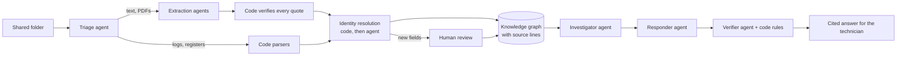

# Concept: an evidence-backed troubleshooting assistant

## The customer's problem

A manufacturer's technicians lose hours finding information when a production line
stops. What they need is scattered across a shared folder of disconnected files: raw
machine logs, shift handovers, maintenance notes, spare-parts and stores exports, and
PDF manuals. There are no databases or APIs, and the customer cannot yet say what data
is valuable or what the product should be. They know only the symptom: *"When a machine
goes down, it takes our technicians hours to find the right information to fix it."*

## Discovery: one workshop, one recent stoppage

A focused half-day with a technician, a maintenance lead and whoever owns the factory's
systems. We reconstruct one recent stoppage, look at the files actually used, and
agree a small pilot.

| Ask | Decision it informs |
|---|---|
| Which stoppages recur, and where is the time lost? | First equipment and failure types to cover |
| What must a technician decide in the first minutes? | The answer the assistant must give, and its follow-up questions |
| Which records are trusted? Who confirms repairs and document revisions? | Which sources count as evidence; who reviews changes |
| What may technicians do themselves, and when must they escalate? | Advice boundaries and procedure references |
| How often do files change, and where may their contents be processed? | Ingestion frequency and deployment model |
| How will we know it helps? | Pilot measures, starting with time to usable information |

For this PoC the answers are our stated assumptions (below). In a real engagement
the workshop would confirm or change them.

## Assumptions

| Area | Assumption | Consequence |
|---|---|---|
| Users | Shift technicians and maintenance leads on one packaging line | Plain language; one question at a time |
| Data | A shared folder of files, added to over time | Ingest from a registered folder; rebuild incrementally |
| Language | English documents | No translation layer in the pilot |
| Authority | The assistant advises; people decide, repair and restart | No machine control, ordering or restart permission, ever |
| Safety | Site procedures govern physical work; their full text may not be in the folder | Refer to the procedure and the maintenance lead; never invent steps |
| Freshness | Files are snapshots, not live status | Every count and record keeps its date |
| Deployment | The knowledge graph and app run inside the customer's network; model calls go to an approved provider endpoint | For stricter data sovereignty, swap in a regionally hosted or on-premise model. The pipeline does not depend on one provider |

## Requirements

**Functional**
1. Turn the messy folder into structured knowledge without per-file programming, and
   keep exact source lines for every fact.
2. Tell apart what records *say* from what they *prove*: observations, guesses and
   confirmed findings; old configurations versus current ones; dated stock versus
   availability.
3. Answer a technician's first questions in seconds: what happened, which guidance
   applies, what was done before, which part fits and whether one was in stock.
4. Ask instead of guessing when a machine reference is ambiguous.
5. Let a person approve changes to the knowledge model (for example, a new stock column)
   without blocking anything else.

**Non-functional**
- Traceable: every statement links to its source lines.
- Safe: no advice beyond the site boundary; unverified claims are left out.
- Reproducible: a build can be replayed exactly without model calls.
- Measurable: construction and answers are evaluated separately, against a simpler
  baseline.

## The pilot scenario

A fictional packaging line ([data](../data/README.md)). On 14 October at 08:20 a
technician asks:

> "The outfeed belt stopped twice after the carton changeover. The drive says motor
> overload. What should I check next?"

The answer is scattered across six files:
- the equipment walkdown gives "outfeed belt" as CV-01, configuration B, with drive D-01;
- the controller log has two overloads, one exported twice;
- the shift note has scraping near the outfeed and an operator's guess about the motor;
- the configuration B manual (not the archived configuration A copy) lists mechanical
  resistance among the possible causes;
- the maintenance history has an older overload on a different setup;
- the site policy sets the procedure boundary.

A good answer connects these, keeps the guess a guess, suggests checking for mechanical
resistance under the site procedure, and asks where the scraping was heard. When the
technician later reports a roller that barely turns, the assistant should name the
approved part (RA-200B, not RA-200A) and show yesterday's dated stock count, which must
be confirmed with stores.

A second line (a carton buffer with detector stops) uses the same pipeline unchanged.

## Solution in one picture

- [Knowledge model](knowledge-model.md): what the graph contains and how files map to it.
- [Construction pipeline](construction-pipeline.md): the multi-agent build.
- [Technician assistant](technician-assistant.md): the answering agents, with a trace.
- [Target architecture](target-architecture.md): the proposed production system beyond the PoC.
- [Evaluation](../evaluation/README.md): the results.

## Key design decisions

| Decision | Why |
|---|---|
| Agents point at source text; code verifies and publishes | Models are good at reading messy text and bad at being trusted. Every fact is checkable |
| Deterministic parsers for structured exports | Logs and registers have a fixed layout; a parser is exact and free |
| Triage decides by content, never by file name | Customer folders are inconsistent; new files must work without code changes |
| A small, explicit ontology (10 node types) | Enough for the decisions technicians make; extensions go through review |
| Human review only for schema changes and genuine ambiguity | People review what needs judgement; routine facts flow through |
| Recorded agent decisions, replayable | Demos and tests are exact and free; changed files re-run only what changed |
| An in-memory graph, with Neo4j optional | Allowed for the PoC and simpler to run; Neo4j projection exists for inspection |
| Three answering agents with code rules | Splitting gathering, writing and checking lets each be simple and testable |
| Count, record and stock text rendered by code | A model never rewrites a quantity or a finding's certainty |
| Evaluate against a document-search baseline | The graph's value is a hypothesis to test, not assume |

## What the evaluation says

With graph tools alone the assistant made no material errors in 48 judged answers,
against 6 for the same agents using document search; those errors included advising a
motor replacement on a guessed machine. Document search was more complete on new
questions, because the graph reaches only what its model captures. Adding a bounded
source-text fallback (graph first) raised the graph system to 45/64 passed answers
against 32/64 for document search, with 1 material error against 8
([details](../evaluation/README.md)).

## Pilot plan and the path to production

| Phase | Scope | Success measure |
|---|---|---|
| Pilot (6–8 weeks) | One line, its real folder, 5–10 technicians | Time to usable information versus today; error and escalation review by the maintenance lead |
| Harden | Versioned file updates, OCR for scans, a correction queue for held items, authenticated reviewers | Held items cleared within a shift; no material errors in reviewed answers |
| Scale | More lines; scheduled ingestion; controlled-document links; access control; monitoring | Coverage per line; adoption; recurring-fault insights |

What production adds that the PoC leaves out: access control and audit, controlled
document management, incremental scheduled ingestion, monitoring of answer quality, and
an agreed model and data boundary ([target architecture](target-architecture.md)).

## References

These inform the design; they do not prove its performance.

- [Bosch: Neuro-symbolic AI](https://www.bosch.com/research/bcai/neuro-symbolic-ai/):
  industrial knowledge graphs combined with domain expertise and rules.
- [Microsoft GraphRAG: local search](https://microsoft.github.io/graphrag/query/local_search/):
  graph relations combined with source text for entity-focused questions.
- [Anthropic: Building effective agents](https://www.anthropic.com/research/building-effective-agents):
  simple, composable agents with bounded tools and clear stopping points.
- [W3C PROV-O](https://www.w3.org/TR/prov-o/): provenance concepts we borrow (without
  claiming conformance).
- Motor-overload troubleshooting notes from drive and conveyor vendors (Schneider
  Electric, Honeywell Intelligrated) support the general mechanism in our fictional
  case: overload has several possible causes, binding rollers among them.
