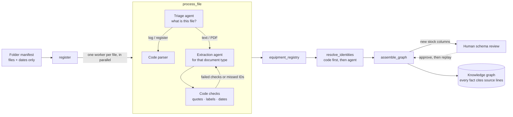

# Knowledge-graph construction pipeline

**One pipeline turns any registered folder of messy files into an evidence-backed
knowledge graph.** Agents decide what each file is and what it says; code checks every
claim against the file before anything is published. Nothing in the pipeline depends
on a file name, a source ID or a particular machine.



The coordinator is a LangGraph `StateGraph` in
[pipeline.py](../src/factory_assistant/pipeline.py). `process_file` runs once per file
through LangGraph's `Send` fan-out, so files are processed concurrently and one bad file
never stops the others.

## Who decides what

| Step | Agent decision (typed output) | Code responsibility |
|---|---|---|
| Triage | Document type plus a second choice, with a reason | Route to a parser or to that type's extraction agent |
| Structured formats | — | Controller logs and equipment registers are parsed deterministically; the same event in several exports merges into one, conflicting copies are held |
| Extraction | Facts for that document type, each pointing at source text (`Quote` for passages, `Label` for short values) | Find every quote in the file, reject sentences given as labels, check that normalised dates are actually written there |
| Correction | One retry, given the failed checks and any tag-like IDs it missed | Keep the retry only if it fixed something without losing facts; if the retry fails, the facts that passed stand |
| Re-route | — | If the first type yields nothing usable, try triage's second choice once |
| Identity | For mentions code cannot match: match / ambiguous / unresolved, with a reason | Exact ID, name, alias or hyphen variant first; agent matches must name a registry ID and stay labelled `agent:`; if the agent fails, code's matches stand |
| Schema change | Proposed meaning for unfamiliar stock columns | File a proposal and hold those records until a person approves |

The agents and their prompts are in [agents.py](../src/factory_assistant/agents.py); the
output contracts are in [contracts.py](../src/factory_assistant/contracts.py). The checks
are in [extract.py](../src/factory_assistant/extract.py) and
[evidence.py](../src/factory_assistant/evidence.py); linking is in
[assemble.py](../src/factory_assistant/assemble.py).

## Why agents point at text instead of writing facts

The model never supplies evidence. It says "line 5 says `CT-200`" and code checks
that line 5 really contains `CT-200` (whole-word, ignoring only case and whitespace),
then stores the line exactly as the file has it. A paraphrase, an invented alias or a
wrong line fails, and the failure message goes back to the agent once. What still fails
is **held**: it is listed for review and kept out of answers. The rest of that file
still publishes.

This is **quote validation**: it shows that each value is written in the file, not that
the values belong together. For the two relationships answers rely on most, code also
checks the statement they come from:

- **Part approvals:** the part and its configuration must come from one statement, and
  that statement must not be a prohibition or non-substitution ("RA-200A and RA-200B are
  NOT approved substitutes" is not an approval).
- **Manual applicability:** a configuration named in an exclusion ("not for
  configuration A") does not make the manual apply to it.
- **Maintenance records:** every field of a job must come from that job's own entry,
  which runs from its reference or date line to the next job's. A record that takes
  "motor replaced" from the next job is held, even though each quote is in the file.
- **Alarm codes:** if two manuals give the same code different meanings, neither is
  chosen and events link to no meaning. (Proper fix: one alarm per model, linked through
  the manual that applies to the machine.)

Some checks that came out of real failures during development:

- **A `Label` must be the value, not its sentence.** The agent quoted
  `Applies only to CT-200 configuration B.` as the model, so labels must look like
  identifiers. The feedback lists candidate tokens from that text.
- **Whole-word matching.** Case-insensitive search first matched configuration `B` to
  the "b" in "belt", so exact-case, whole-word matches win.
- **Missed identifiers.** One run dropped CV-02 from the walkdown. Tag-like IDs in the
  text that the extraction never used go back to the agent as hints, not facts.
- **Re-routing.** Triage sometimes calls an emailed work-order closeout a shift
  handover. When the handover reading produces nothing, the second choice is tried.

## What it builds

The graph's node and link types, the distinctions it keeps and a file-by-file mapping
are in the [knowledge model](knowledge-model.md).

## Replay, live and incremental builds

Every agent decision is cached in [agent_cache/](../agent_cache) by its exact
instructions, output contract and input. The cache is committed, so:

- **Replay** (default) rebuilds the graph with no model calls, exactly as recorded.
- **Live** calls the model only for inputs not seen before. Add or edit one file and
  only that file's decisions are new.
- Changing a prompt or a file invalidates exactly the decisions it affects. Replay then
  holds those files with "run a live build" instead of guessing.

```sh
.venv/bin/factory-demo build                  # replay recorded decisions
.venv/bin/factory-demo build --mode live      # call agents for new or changed files
.venv/bin/factory-demo build --folder data/scenarios/sensor_stop
.venv/bin/factory-demo proposals              # schema changes awaiting review
```

## Adding, changing and removing files

In **Build & review → Add a file**, a data owner drops in a new file; it is dated at
the moment of upload. It is stored with the app's runtime data
([uploads.py](../src/factory_assistant/uploads.py)), never in `data/` or the committed
manifest. The whole folder is then rebuilt: only the new file goes to the agents, and
their decisions are cached beside it, not in `agent_cache/`. The tab streams each
pipeline step and then shows what triage made of the file, the records and links that
cite it, what changed since the previous build, and anything held. Try it with
[demo_files/night_shift_15oct.txt](../demo_files/night_shift_15oct.txt).

Every build starts from the registered files, so the graph never keeps stale facts:

- **Removed file:** its facts are gone after the next build (an added file has a
  Remove button).
- **Changed file:** its new content gets new agent decisions; facts from the old text
  are gone. The old build is kept in `.runtime/graphs`.
- **Earlier views:** a fact keeps only the citations from files registered by the
  question time, so a later file that mentions the same part or machine never hides
  what was known earlier.

Not handled yet: an edited file keeps its original registration time, so an earlier
view sees the new text. The fix is to register a changed file as a new version with
its own time and a link to the version it supersedes. Facts also have no validity
period: if a machine's configuration changes, the two files disagree and the
configuration is held for review instead of being recorded as "B until 20 October,
then C". In an earlier view that means the machine shows no configuration, although
the earlier file alone gave one. Equipment names are merged the same way: a name first
written in a later file still finds the machine in an earlier view. Both need facts
with their own validity period (versioned assertions).

## Human review of schema changes

The stores export `stores_export_16oct.csv` has a reserved-quantity column that the
stock model does not define. The mapping agent proposes a field and a meaning; the
build files a proposal ([review.py](../src/factory_assistant/review.py)) and holds only
that file's records. In **Build & review → Review schema changes**, a reviewer approves,
edits (a new revision that needs its own approval), rejects or defers it. Approval adds
the field and replays the build, so the records publish without new model calls.
Counts stay dated snapshots. Approval changes the schema, not the truth of any count.

## Results

On the shared folder (15 files: text, logs, CSV, PDF) with `gpt-4.1-mini`:

- **53/53 gold checks in 3 of 3 fresh live runs** (empty cache), about 12 s per build
  ([stability record](../evaluation/results/construction-pipeline-stability-2026-10-26.json)).
  The gold files are hand-written development assertions and are never shown to agents.
- Held in every run, correctly: callout N3 ("outfeed" could be CV-01 or CV-02) and the
  C3 stock columns awaiting review. The walkdown's "carton packer → CV-01" flow is held
  because the carton packer has no identifier.
- The same pipeline builds the separate sensor-stop folder with no code change. A test
  renames its machine and alarm code and the graph follows.

These are synthetic development files. The numbers show the pipeline works and is
repeatable on them, not that its accuracy carries over to a real factory's documents.

## Known limits

- Statement checks cover approvals, applicability and maintenance-record boundaries.
  An approval listed under a separate configuration heading (not in the same statement)
  is held, not guessed.
- Supported document types are the nine triage types; anything else is held as
  unsupported. A new type needs a contract and its guidance (a small, explicit change).
- Omissions can only be caught where code has a signal (tag-like IDs in equipment lists).
  A missed sentence in a maintenance note is not detected automatically.
- Only schema changes have an interactive review. Other held items are listed for a
  person to fix at the source; there is no correction editor yet.
- PDFs must contain selectable text (no OCR). Files are capped at 20 pages or 100 KB of text.
