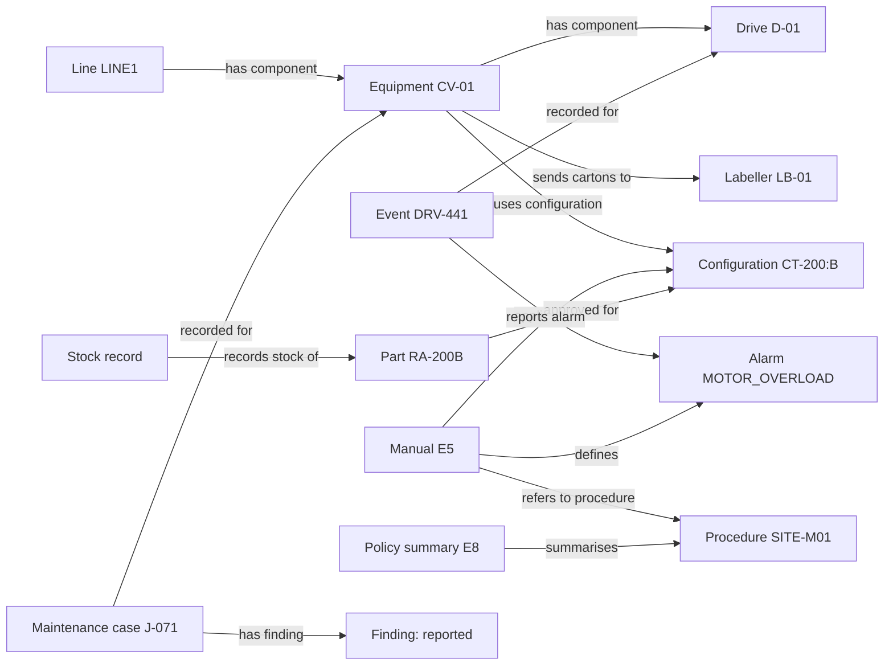
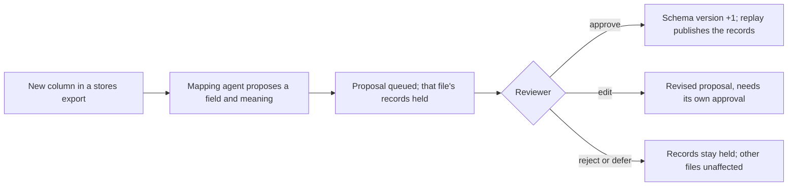

# Knowledge model

**A small, explicit ontology:** ten kinds of node and twelve kinds of link, chosen for the
decisions a technician makes in the first minutes of a stoppage. Every node and link
carries the exact source lines it came from. Definitions are in
[graph_models.py](../src/factory_assistant/graph_models.py).

## What the graph contains

| Node | Meaning | Key properties |
|---|---|---|
| Equipment | A tagged asset or numbered line | name, aliases |
| Configuration | A model and its configuration label (`CT-200:B`) | model, configuration |
| Event | A timestamped controller event, or a shift-note statement | occurred_at, code, message; notes are `HANDOVER_NOTE` or `UNVERIFIED_SUSPICION` |
| AlarmType | An alarm code as defined by a manual | code, meaning |
| MaintenanceCase | One historical job or work order | date, reported problem, work, outcome, configuration at the time, how the equipment was identified |
| Finding | A case's finding, with the source's certainty | text, status: reported / suspected / confirmed |
| Part | A part number | description |
| StockRecord | A dated stores count | part, location, counted_at, quantities as recorded |
| Document | A source file, with its full text and page map | role (from triage), manual metadata and sections |
| ProcedureReference | A site procedure | details_available (is the full text in the folder?) |

| Link | From → to |
|---|---|
| HAS_COMPONENT | Equipment → Equipment |
| SENDS_TO | Equipment → Equipment (material flow) |
| HAS_CONFIGURATION | Equipment → Configuration |
| APPLIES_TO | Document (manual) → Configuration |
| APPROVED_FOR | Part → Configuration |
| STOCK_OF | StockRecord → Part |
| RECORDED_FOR | Event or MaintenanceCase → Equipment |
| REPORTS_ALARM | Event → AlarmType |
| DEFINES | Document (manual) → AlarmType |
| REFERENCES | Document (manual) → ProcedureReference |
| DESCRIBES | Document (policy) → ProcedureReference |
| HAS_FINDING | MaintenanceCase → Finding |

Code controls which node kinds a link may join; a model can never create a link type or
write a query.

## Distinctions the model keeps

These are the mistakes that cost technicians time or cause wrong repairs:

| In the files | Kept as | Never assumed |
|---|---|---|
| `CV-01 = "outfeed belt"` | An alias on CV-01 | That every "outfeed" means CV-01 |
| DRV-441 exported twice | One event with two source lines | Three overload stops |
| "Motor getting tired? Just my guess" | An `UNVERIFIED_SUSPICION` note | A motor fault |
| J-093 replaced a motor on CV-02 | A case recorded for CV-02 | That CV-01's motor was replaced |
| J-071 on configuration A | The configuration at the time of the case | That today's configuration B applies to it |
| Two CT-200 manuals | Each applies to its stated configuration | That the newest manual applies |
| One RA-200B in yesterday's count | A dated stock record | Current availability |
| "Possibly the cover seal" | A `suspected` finding | A confirmed cause |

Applicability is a path, not a guess: **CV-01 → CT-200:B ← manual E5** and
**CV-01 → CT-200:B ← part RA-200B**. A manual applies to a configuration, never directly
to a machine.

## From files to graph

What the [construction pipeline](construction-pipeline.md) produced from the shared
folder (66 nodes, 53 links):

| File | Triaged as | Read by | Became |
|---|---|---|---|
| equipment_notes.txt | equipment list | extraction agent | 13 equipment, 2 configurations, component and flow links |
| filling_equipment.csv | equipment list | register parser | 3 equipment, 3 configurations |
| morning_export.log | event log | log parser | 5 events (duplicate merged), alarm links |
| shift_handover.txt | handover | extraction agent | 5 notes, one marked as an unverified suspicion |
| maintenance_history.txt, friday_closeout.txt, fitter_notebook.md, work_orders_october.pdf | maintenance history | extraction agent | 7 cases, 6 findings with certainty labels |
| unassigned_callout.txt | maintenance history | extraction agent | Held: "outfeed" is ambiguous |
| CT-200 manuals (2 PDFs) | manual | extraction agent | Applicability, sections, the MOTOR_OVERLOAD definition, the SITE-M01 reference |
| approved_parts.txt | approved parts | extraction agent | 2 parts approved for their configurations |
| stores_snapshot.txt | stock list | mapping agent + table parser | 3 dated stock records |
| stores_export_16oct.csv | stock list | mapping agent + table parser | Held for review: new reserved-quantity column |
| site_maintenance_boundaries.txt | policy summary | extraction agent | SITE-M01, full procedure not available |

## Evidence on every fact

Each node and link stores, for every supporting line: source ID, file path, file hash,
line number, the line's exact text and (for PDFs) the page. The assistant can therefore
show the original wording behind any statement, and a citation whose text no longer
matches its file is excluded. This borrows provenance ideas from W3C PROV without claiming
conformance.

Time is part of the evidence. Each file has a registration time, and each question has a
cutoff ("records as of 08:20"). Files added later stay out of earlier views, so the
assistant cannot use information the technician did not yet have. A fact keeps only the
citations known at the cutoff: when a later stores export also mentions RA-200B, the
14 October view still shows the approval and the count known then.

## How the model changes

The ontology grows only through review. Today this is implemented for stock fields:

Approval changes the schema, not the truth of any count. Missing values stay unknown
(an absent reservation is never zero), and every decision is kept
([review.py](../src/factory_assistant/review.py)). Adding a new node or link type is a
deliberate code change with its own extraction contract, not something an agent does on
its own.
