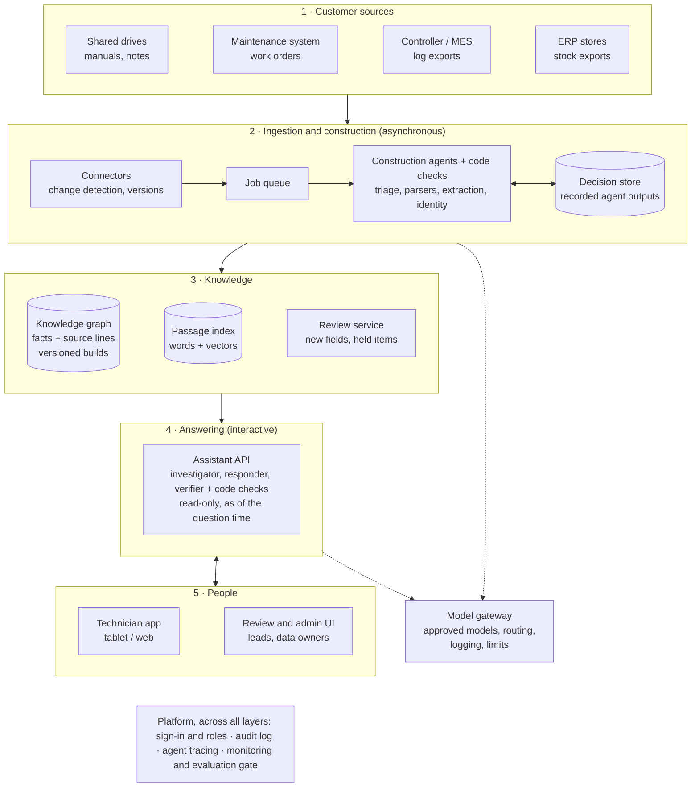
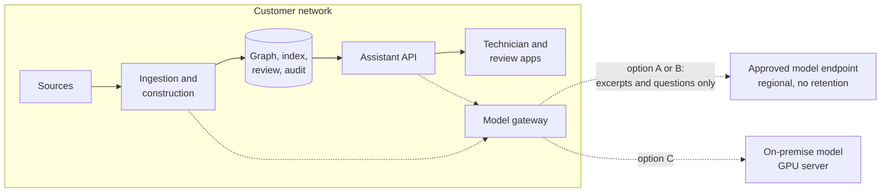
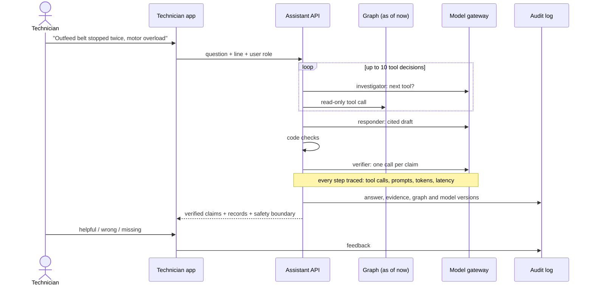

# Target architecture (proposal beyond the PoC)

> **This is a proposed design, not what this repository runs.** The PoC is one local
> process: a Streamlit app, a LangGraph build, an in-memory graph and direct model calls
> (see the [README](../README.md#how-it-works), the
> [construction pipeline](construction-pipeline.md) and the
> [technician assistant](technician-assistant.md)). Everything below that is not in the
> PoC is marked as production, and tools are named as options to choose in the pilot.

**The PoC proves the mechanism on one machine; production keeps its two pipelines and their
contracts and replaces what surrounds them.** The construction agents, the evidence model,
the link rules, the as-of view and the answer checks stay as they are. Storage, scheduling,
model access, identity and monitoring become services.

## Target system

Two flows, as in the PoC:
- **Build (asynchronous):** a file arrives or changes → its job runs → only new inputs go to
  the agents → code checks every pointer → the graph publishes a new version. Anything
  unverifiable or new to the schema waits in review without blocking the rest.
- **Answer (interactive):** a technician asks → the assistant reads the graph as of the
  question time with read-only tools → drafts, checks and verifies → the answer, its
  evidence and every version involved are logged.

## What stays the same

These are the parts that make answers trustworthy, so they move to production unchanged:

| Kept | Where it lives today |
|---|---|
| Typed agent contracts; agents point at text, code verifies | [contracts.py](../src/factory_assistant/contracts.py), [extract.py](../src/factory_assistant/extract.py) |
| Ten node and twelve link types, link rules enforced in code | [graph_models.py](../src/factory_assistant/graph_models.py) |
| Source lines, file hash and page on every fact | [evidence.py](../src/factory_assistant/evidence.py) |
| As-of view per question | [query_tools.py](../src/factory_assistant/query_tools.py) |
| Read-only tools, citation limits, section rules, per-claim verifier, code-rendered records and safety boundary | [assistant.py](../src/factory_assistant/assistant.py) |
| Recorded decisions keyed by instructions, contract and input | [agents.py](../src/factory_assistant/agents.py) |
| Gold checks and rubric evaluation against a baseline | [evaluation/](../evaluation/README.md) |

## From PoC to production

| Concern | PoC today | Production |
|---|---|---|
| Sources | A registered folder and a manifest | Connectors for drives, the maintenance system and exports; change detection; every file version kept |
| Orchestration | LangGraph in one process, started from the CLI or the app | The same graph run by queue workers; scheduled and on-change; retries and a dead-letter list |
| Agent decisions | `agent_cache/` JSON in git | A decision store keyed the same way, with prompt and model versions |
| Graph | In-memory bundle saved per build; optional Neo4j projection | Neo4j (or equivalent) as the primary store; each build a version; switch to a new build only after its checks pass |
| Facts over time | File registration time and the as-of filter | Versioned assertions with validity periods ("configuration B from 1 Sep") |
| Passage search | Word match plus an SQLite embedding cache | A vector index in the graph store or a separate index |
| Review | SQLite ledger and a Streamlit tab | A review service with roles, a queue for held items and notifications |
| Answering | A Python loop inside the Streamlit process | A stateless assistant API with time, tool and token budgets |
| Model access | Direct calls to one provider | A model gateway: approved models per task, routing, logging, cost limits, swappable provider |
| Agent tracing | Each answer keeps its trace (tool calls and results, drafts, rejected claims) in its result JSON; the evaluation runner adds token use per model call; each build keeps a per-file trace of agent decisions | The same traces sent to a tracing tool: searchable, linked to feedback and evaluation runs |
| User interface | Streamlit | Technician app for the shop floor; review and admin UI; later links from the maintenance system |
| Identity and access | None (local demo) | Company sign-in; roles for technician, lead, data owner and reviewer; data access per line or site |
| Audit | Answer JSON download | Every answer stored with its evidence, graph version and model versions |
| Quality | `tools/evaluate.py` run by hand | Evaluation gate on every prompt or model change; technician feedback; sampled expert review |
| Documents | Text PDFs only, up to 20 pages | OCR for scans; table extraction; controlled-document links |

## Tooling options

Named as candidates for the pilot, not decisions. The contracts above do not depend on them.

| Need | Options | Choose by |
|---|---|---|
| Agent tracing: every tool call, prompt, output, token count and latency per run | [Langfuse](https://langfuse.com) (open source, self-hostable), [LangSmith](https://www.langchain.com/langsmith) (native to LangGraph; cloud or self-hosted), [Arize Phoenix](https://phoenix.arize.com) (open source) | Traces contain file text and questions, so they must stay inside the data boundary: self-hosted unless the customer accepts a cloud service |
| Model gateway | [LiteLLM](https://docs.litellm.ai) proxy (open source: one API for many providers, keys, budgets, fallbacks, logging), or the customer cloud's own AI gateway | Which deployment option below is allowed |
| Evaluation runs | The tracing tool's datasets and experiments, with `tools/evaluate.py`'s cases, judge and baseline as the gate logic | Same tool as tracing, so a failing case opens its trace |
| Graph store | Neo4j (the PoC already projects to it); alternatives if the customer has a graph platform | Existing platform and query language |
| Build jobs | A task queue with workers, or a workflow engine the customer already runs | Existing IT platform |

**Our starting suggestion:** self-hosted Langfuse behind a LiteLLM gateway. Both are open source,
run inside the customer's network, and connect to each other (the gateway sends every model call
to the tracing tool). LangSmith is the natural choice if the team standardises on LangChain tools
and a cloud service is acceptable.

## Deployment and data boundary

The graph, the source files and the audit log never leave the customer's network. What crosses
the gateway is what a prompt needs: a file's text for extraction, and for answers the question
and the evidence cards.

| Option | Model runs | Fits when |
|---|---|---|
| A. Provider API | A regional endpoint with no data retention | Fastest start; the customer accepts prompt data leaving the site |
| B. Customer's cloud tenant | A model hosted in the customer's own cloud subscription | Data must stay in the customer's tenant and region |
| C. On premise | An open-weights model on local GPUs | No external calls allowed; expect a capability check against the evaluation set first |

The pipeline does not depend on one provider: agents are called through typed contracts, and the
evaluation set tells us whether a different model is good enough before it is switched on.

## One question in production

## Proposed targets for the pilot

Starting points to agree in the workshop, not measured production figures.

| Quality | Target | PoC today |
|---|---|---|
| Answer time | Under 15 s for a typical question | Median about 10 s (evaluation runs) |
| Freshness | A new or changed file in the graph within 15 minutes | Manual build |
| Traceability | Every released statement cites source lines | Enforced by the answer contract |
| Material errors | None in answers reviewed by the maintenance lead | 1 in 64 judged answers |
| Availability | All production shifts | Single laptop |
| Held items | Cleared within one shift | Listed in the build, fixed at the source |

## What each phase adds

The phases follow the [pilot plan](concept.md#pilot-plan-and-the-path-to-production).

| Phase | Adds |
|---|---|
| Pilot, one line | Connector for the line's folder, scheduled builds, Neo4j as the store, the technician app with sign-in, audit log, agent tracing, feedback button |
| Harden | Versioned files and facts, OCR, held-item queue in the review service, evaluation gate in the release process, model gateway |
| Scale, more lines and sites | Connectors to the maintenance system and stores, per-site access, monitoring dashboards, recurring-fault reports for leads |

## Risks and how the design contains them

| Risk | Containment |
|---|---|
| A model update changes behaviour | Pinned model versions; evaluation gate before any switch |
| Bad or contradictory source data | Held items and review; conflicting facts are held, not merged |
| Technicians over-trust answers | Advisory only; cited lines one click away; safety boundary added by code; feedback reviewed |
| Provider lock-in or data-sovereignty change | Model gateway and typed contracts; options A to C above |
| The graph misses a fact it does not model | Bounded source-text fallback; new node types added through a reviewed change |
