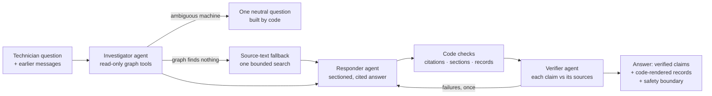

# Technician assistant

**Three agents answer a technician's question from the knowledge graph:** an
investigator gathers evidence with read-only graph tools, a responder writes a short
sectioned answer, and a verifier checks each claim against only the sources it cites.
Code enforces the rules a prompt cannot guarantee.

## What it is for

The pilot scope is deliberately narrow: the questions a technician asks in the first
minutes of a stoppage.

| Question type | Example | What the answer contains |
|---|---|---|
| Stoppage or alarm | "The outfeed belt stopped twice… motor overload. What should I check next?" | What the records show, the manual's possible causes, next checks with the procedure, one question |
| Follow-up with a finding | "We found a roller underneath that barely turns. Which part, and is one in stock?" | The finding in context, the approved part, the dated stock record |
| Applicable guidance | "Which manual applies to CV-01, and why?" | Machine → configuration → manual, with the path cited |
| Past work | "What maintenance has been recorded on the outfeed belt?" | The matching job records, verbatim |
| Parts | "Can RA-200A be used instead of RA-200B on CV-01?" | The approval path and the non-substitution statement |
| Unclear machine | "The outfeed stopped. What should I check?" | One question: CV-01 or CV-02? |

Out of scope: live machine or stores status, ordering, scheduling, procedures that are
not in the folder, and comparisons across many machines.

## The three agents

**Investigator** ([assistant.py](../src/factory_assistant/assistant.py)) picks one
read-only tool at a time, up to ten decisions
([query_tools.py](../src/factory_assistant/query_tools.py)). The key tool is
`troubleshooting_context`. In one graph traversal it collects:
- the machine's configuration and the manual that applies to it (not the archived manual
  for the other configuration);
- events on the machine and its components, with duplicate exports counted once;
- the alarm definitions those events report;
- shift notes for the machine or its line, with guesses labelled;
- past maintenance cases and the site procedure.

The graph does this across six files in one call. Other tools cover equipment lookup,
history, approved parts, stock, graph walks and passage search.

**Source-text fallback.** `search_documents` searches the text of every file available
at the question time, for what the knowledge model does not hold (a caveat in a stores
file, a remark in a shift note). It keeps the graph's boundaries: manuals only through
their applicability path, stock numbers only from the reviewed stock tool, and a file
whose machine is unresolved is returned labelled as a held record (it exists; which
machine it is about is unknown). The investigator rarely chose it on its own,
so when an investigation ends with no evidence, code runs one bounded search and the
responder gets the passages. They are labelled as source text: a passage may be used
only for what it states itself.

**Responder** writes `findings`, `possible_causes`, `next_steps` and at most one
`question` ([assistant_contracts.py](../src/factory_assistant/assistant_contracts.py)).
The contract only accepts citation IDs that this run's tools actually returned. Its
question goes to the verifier too, with the cards behind the answer, and is dropped if
what it assumes is not supported. A clarification from the investigator is replaced by a
neutral question built by code from the candidate machines, so it can assert nothing. Counts,
maintenance records and stock are selected by ID and rendered by code, so a model never
rewrites a quantity or a historical finding.

**Verifier** checks each claim in isolation against only its cited cards. It rejects
overstatements, such as a guess stated as fact, a reported finding presented as the
proven cause, or "in stock" inferred from a dated count.

## One execution trace

The main incident question, from the final evaluation run
([answer and verdict](../evaluation/runs/2026-10-26-final/report.md)). Records as of 08:20.

| Step | Agent / code | Action | Result |
|---|---|---|---|
| 1 | Investigator | `find_equipment("outfeed belt")` | Resolved to CV-01 by its recorded alias |
| 2 | Investigator | `troubleshooting_context("CV-01")` | Manual E5 via CV-01 → CT-200:B ← E5 (E6 excluded); 5 manual sections; events: 2 × MOTOR_OVERLOAD (duplicate counted once), 1 × RUNNING; alarm definition; 5 shift notes, one labelled an unverified suspicion; cases J-071 and J-108; procedure SITE-M01 |
| 3 | Investigator | `search_passages("motor overload drive stop outfeed belt")` | Matching manual and note passages |
| 4 | Investigator | `finish_retrieval(answer)` | Hand over to the responder |
| 5 | Responder | Draft | 3 findings, 2 possible causes, 3 next steps, records selected: event count, J-071, J-108 |
| 6 | Code | Section rules | Causes cite the manual; steps cite manual/policy: pass |
| 7 | Verifier | 8 isolated claim checks | All supported |
| 8 | Code | Release | Safety boundary added from SITE-M01 (`details_available: false`) |

Released answer, in short:
- **Records:** two overload stops, scraping reported near the outfeed after the carton
  changeover.
- **Possible causes:** mechanical resistance or obstruction (for example, binding
  rollers), motor problems, or motor configuration. These come from the manual.
- **Next steps:** inspect for resistance under SITE-M01, following its isolation process,
  and ask the maintenance lead for the full procedure.

There were 13 model calls in about 11 s: 4 investigator decisions, 1 draft and
8 verifications, about 30k tokens.

The trace also shows a limit. One finding says the old packing material "caused" J-071's
overload, which states a *reported* finding as a cause. The verifier let it through; the
code-rendered record beside it keeps the correct wording ("reported in the source").

## Rules enforced in code

- A possible cause must cite guidance that lists it (a manual).
- A next step must cite guidance, a procedure, the parts list or a stores note.
- Numbers from stock files are never cited in claims; a stores file's notes may be.
- Claims cannot restate maintenance or stock records; those are shown as recorded.
- After one correction, claims that still fail are **left out individually** and the
  answer says how many were removed. Only answer-level failures withhold the answer.
  The selected source records are still shown when available.
- Any answer with next steps carries the site's safety boundary. It is built from the
  graph's procedure references and site policy, not from model wording.
- The technician's own messages are a citable card (`your report`). They are evidence of
  what was reported, not guidance.

## Results

Scored on 32 rubric cases against a document-search baseline
([evaluation](../evaluation/README.md)): **45/64 fully passed answers with 1 material
error** (baseline: 32/64 with 8). Without the fallback the graph tools made no material
errors but missed facts outside the knowledge model; the fallback recovers most of them.
A record whose machine is unresolved comes back labelled as held, so the answer says the
machine is unknown instead of filling the gap. Recorded stock is shown as its own card
whenever the stock lookup ran, so "do we have it?" gets the dated count, and the responder
may not ask the technician to look up records. The remaining error gave CV-01 a motor
replacement that was CV-02's (the verifier missed it); an earlier run's error inferred
live status from the log.
Readable live examples are in
[assistant-examples-2026-10-26.md](../evaluation/results/assistant-examples-2026-10-26.md).

Known weak points: some questions are routed to the wrong tool (events instead of history),
it asks which machine when the record would say, and answers vary between runs because
the investigator and responder are live models.
